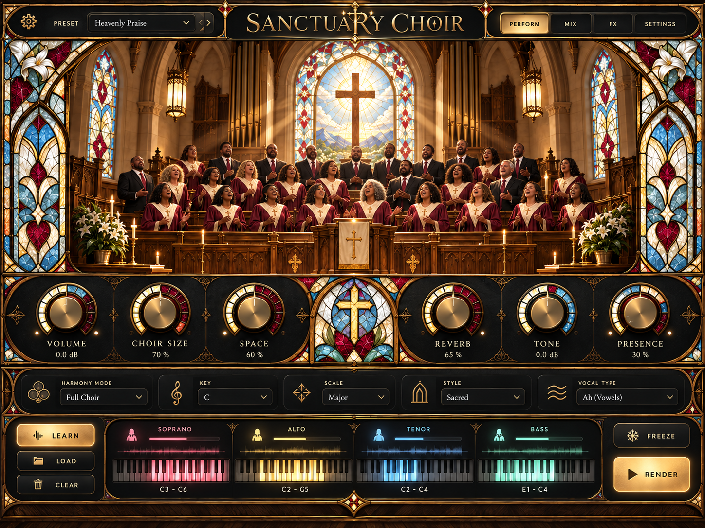

# Sanctuary Choir

**Turn one voice into an entire choir.** Sanctuary Choir is an audio plugin (VST3 / AU / Standalone) that listens to your singing and surrounds it with a full SATB choir: sopranos, altos, tenors and basses, harmonised in your key, placed on a cathedral stage and bathed in a real-sounding room.



## Features

The plug-in carries its own manual: **Settings → Manual**, or the gear at the top left. It walks through every feature in plain words, with a numbered tour of the main page, recipes, troubleshooting and a search ([docs/USER_GUIDE.md](docs/USER_GUIDE.md) has the same for reading outside it).

**Perform page**
- **Choir Size** adds singers one at a time (up to 40). You watch them walk into the choir loft as you turn the knob.
- **Volume, Space, Reverb, Tone, Presence** shape the sound. Space spreads the singers across the stage and adds early reflections.
- **Energy**: how hard the choir sings, from hushed to massive, on the main page.
- **Harmony Mode**:
  - Full Choir: classic four-part hymn voicing with voice leading.
  - Gospel Stack: close harmony with 7ths.
  - Open Voicing.
  - Unison & Octaves.
  - Thirds & Sixths.
  - Organum: medieval parallel fourths over a drone.
  - Upper Voices (SSAA) and Lower Voices (TTBB).
  - Drone Pad.
  - MIDI Chords.
- **Key / Scale**: Auto key and scale detection (major, natural or harmonic minor, heard from your melody), or pick from 12 keys and 9 scales:
  - Major, Minor, Harmonic Minor
  - Dorian, Mixolydian, Lydian, Phrygian
  - Gospel/Blues, Chromatic
- **Style** sets how the choir performs (vibrato, looseness, scoops, chord colour): Sacred, Gospel, Gregorian, Cinematic, Worship, Chamber, Spiritual.
- **Vocal Type**:
  - Ah, Oh, Oo, Ee, Eh: pure sung vowels, synthesised per section with real SATB formants.
  - Mm: humming.
  - Words: the choir sings *your lyrics* (your own voice, pitch-shifted and re-voiced per singer).
- **Section panels** for Soprano / Alto / Tenor / Bass:
  - Each panel has a level bar, a live waveform, and a keyboard that lights up the notes being sung.
  - Drag on a keyboard to set that section's singing range.
  - Click the singer icon to mute the section; double-click to solo it.
- **LEARN / LOAD / CLEAR / RENDER**:
  - LEARN: press it and play your song. Sanctuary studies the whole take (notes, phrases, key) and writes smarter harmony with look-ahead: cadences at phrase ends, steady octaves, proper voice leading.
  - RENDER: renders every singer at the highest quality. The result plays back in sync with your DAW timeline.
  - The take is saved with your project.
- **FREEZE** holds the current chord forever, for pads, endings and transitions. In Words mode it sustains your own vowel.

**Beyond the original idea**
- **Response: Echo** (call & response). The choir waits while you sing a phrase, then answers it right back in harmony, gospel style. Switch it on in the MIX page or load the *Call & Response* preset.
- **MIX page**:
  - Per-section fader, pan, mute/solo and singing range.
  - Lead vocal and choir levels.
  - Humanize, Vibrato, Glide, Formant (gender/size), Pitch Lock and Breath.
  - **Sub-Octave**: oktavists, basses doubling the bass part an octave down.
- **FX page**:
  - Six sacred spaces: Grand Cathedral, Stone Abbey, Wooden Chapel, Concert Hall, Gospel Church, Studio Room. Each one appears on screen with its own choir (monks in the abbey for Gregorian chant), chosen from the picker at the top of the scene. Their reverb is a real measured room (a church in Cremona, Aachen Cathedral's St. Nicholas Chapel, the Detmold Brahmssaal, the Arvedi Auditorium, BBC Maida Vale 5; CC BY datasets, see [rooms/CREDITS.txt](rooms/CREDITS.txt)), played by partitioned convolution.
  - Decay, pre-delay and brightness.
  - Lead reverb send.
  - Low/high cut, Warmth and a Glue compressor on the choir bus.
- **MIDI**: hold chords on a keyboard to dictate the harmony. With no voice coming in, the choir becomes a playable instrument.
- **Live monitoring**: your voice comes through almost at once (1.5 ms) while you record; the choir follows about 16 ms behind (Settings → Monitoring).
- **Sanctuary Voices**: real recorded singers sing the vowel modes (Ah, Oh, Oo, Ee, Eh): 1,103 held notes from 20 professional singers (with their breathy, belted and classical takes, about 10,000 recordings in all), sorted into SATB sections, plus their real onsets and note-to-note slides, so legato lines join up and short notes start like sung notes. **Singing** (MIX page) switches them between natural, breathy and belted takes. Installed with the plug-in; switch back to the synthesised voices any time (Settings → Choir Voices).
- **Your own choir**: record a few held notes per section and the vowel modes sing with those real voices ([guide](docs/RECORDING_YOUR_CHOIR.md)).
- **Voice character**: in Words mode the upper sections sound like women when a man sings lead (and the lower sections like men with a female lead).
- **Real voices in Words mode**: each singer takes on the vocal tract, tone and vibrato of one of 19 real singers (measured from VocalSet), so the choir sounds like different people singing your words. No AI involved.
- **Multi-take choir**: sing the part two to four times and the Words choir sings from every pass, lined up note by note with your take (dynamic time warping on the voice's sound, then a time-stretch that leaves the pitch alone). Real doubles with their own breaths and timing, not copies of one voice.
- **Chord Speed** and a one-click **key lock** for the detected key.
- **Chord lane**: after LEARN, see every chord of the take over your melody and the four parts the choir sings. Click one for ranked alternatives (with how well each fits the melody), pick one, and the harmony around it is worked out again. Chosen chords are kept with the project.
- **Drag-out stems and MIDI**: drag the parts (SATB on channels 1–4, melody, named chords) as MIDI, or the rendered Full Choir, section stems, the Room (the hall alone) and your Lead on Stage as 24-bit WAVs, straight into your DAW. They line up when dropped at the start of the song. Or save them all to a folder.
- **Ensemble**: an adult choir, a children's choir (every part sung by trebles), shouted gang vocals, or a whole congregation.
- **Rhythm** (FX page): tempo-synced gates and section arpeggios that follow your DAW: pulses, offbeats, gallops, trance gates, Arp Up/Down/Bounce and Call & Answer.
- **Follows the band**: route your band, keys or backing track to the side-chain and the choir sings the chords they play, inversions included. LEARN records the band too and harmonises every note with the chord under it.
- **Key changes**: LEARN follows a song that modulates (G MAJOR → A MAJOR) and harmonises each part in its own key.
- **MIDI parts and Program Change**: channels 1–4 sing exactly the soprano, alto, tenor and bass notes you write; Program Change picks a preset.
- **Sung words for MIDI**: type "Kyrie eleison", "Alleluia" or "Glory to God" and the MIDI choir sings it, a syllable per note, with real vowels and sung consonants (church Latin or English).
- **Scenes**: 8 stored sounds per song (verse, chorus, bridge), recalled with a click or by automating the Scene parameter.
- **The stage and its microphones**: drag the four sections around the stage, seen from the hall (left/right, forward/back, wide/narrow) or pick a formation, and mix Close, Tree and Room microphones like a recording engineer. Drag yourself onto the stage too, to sing from among the choir and in the hall. Rendered takes follow without rendering again.
- **67 factory presets** in 8 categories (Sacred & Classical, Worship, Gospel, Cinematic, Pop & Backing, Pads & Drones, Rhythmic, Kids & Crowds) plus your own.

## Download

GitHub Actions builds the plug-in for **macOS (universal), Windows and Linux**. While the repository is public, every push builds all three. Once it is private, where Actions minutes are limited (macOS minutes count ten times, Windows twice), pushes and pull requests build only Windows; to build macOS or Linux, open **Actions → Build → Run workflow** and pick the system (or *all*). A `v*` tag always builds all three.

To download a build:
1. Open the repository's **Actions** tab and pick the latest green **Build** run.
2. Download `Sanctuary-Choir-macOS`, `Sanctuary-Choir-Windows` or `Sanctuary-Choir-Linux` under *Artifacts*.
3. Run the installer inside the zip (`Sanctuary Choir Setup.exe` on Windows, `Sanctuary Choir.pkg` on Mac) or follow `INSTALL.txt`.

New here? Read the [user guide](docs/USER_GUIDE.md).

Pushing a tag such as `v1.0.0` also publishes the zips as a GitHub Release.

## Building from source

Requirements: CMake 3.22+, a C++20 compiler (Xcode 15+, Visual Studio 2022, GCC 11+/Clang 14+). JUCE 9 is downloaded automatically.

```bash
cmake -S . -B build -DCMAKE_BUILD_TYPE=Release
cmake --build build --config Release --parallel
ctest --test-dir build -C Release          # DSP unit tests
```

- **macOS universal**: add `-G Ninja "-DCMAKE_OSX_ARCHITECTURES=arm64;x86_64"`.
- **Windows**: install the WebView2 SDK first (`nuget install Microsoft.Web.WebView2 -OutputDirectory C:/webview2`) and add `-DJUCE_WEBVIEW2_PACKAGE_LOCATION=C:/webview2`.
- **Linux**: install the packages listed in `.github/workflows/build.yml`.

The plug-ins land in `build/plugin/SanctuaryChoir_artefacts/Release/`.

There is also a command-line renderer, handy for testing the engine without a DAW:

```bash
./build/tools/render/sanctuary_render vocal.wav choir.wav --learn --voice words --style gospel --size 60
```

## How it works

```
input ─► YIN pitch tracker ─► harmoniser ─────────► control timeline (notes per section, per 5 ms)
   │        (key detection)    (live, or the                     │
   │                            learned score)                   ▼
   └────► PSOLA analyser ─► up to 40 singers ─► S/A/T/B buses ─► stage · Close/Tree/Room mics ─► tone · glue ─► measured room (convolution) ─► + lead ─► limiter
                            (Words: pitch-shifted grains of your voice;
                             vowels: glottal source + SATB formant filters;
                             each singer with its own timing, detune, drift and vibrato)
```

| Folder | What's inside |
| --- | --- |
| `core/` | The DSP engine in plain C++20 (no framework). Pitch tracking, PSOLA, vowel synthesis, music theory and voice leading, harmoniser, reverb (measured rooms by partitioned convolution, and an FDN), Learn analysis, lining up extra passes, and offline rendering. |
| `plugin/` | The JUCE wrapper: parameters, presets, the Learn session (timeline capture, background analysis/render, playback, saving takes with the project) and the WebView editor. |
| `ui/` | The interface: HTML/CSS/JS drawn over artwork taken from the design mockups. Opening `ui/index.html` through a local web server runs it in a browser with a simulated engine. |
| `tools/art/` | Scripts that turn the mockups into the UI skin and the singer sprites. |
| `rooms/`, `tools/rooms/` | The venues' measured rooms (built into the plug-in) and the script that makes them from the datasets, with their sources and credits. |
| `tests/` | DSP unit tests. These cover pitch accuracy, voicing rules, key detection, section pitches in every mode, latency alignment, learn and render, and a CPU budget check. |

The plugin reports its latency (about 40 ms) so your DAW keeps everything in time. For recording and live use, **Settings → Monitoring → Live** passes your voice through almost at once (1.5 ms) and runs the vowel choir about 16 ms behind you (Words keep the full 40 ms); the plugin then reports just the 1.5 ms. The standalone app always runs live.

The 1.5 ms is the output limiter looking ahead. A choir driven past full scale (a big Choir Size at high Energy in a long, loud room) is turned down in smooth ramps that arrive with each peak, rather than clipped sample by sample, which used to be heard as static. The measured rooms are also evened out left to right when they load (Stone Abbey's measurement is 4.7 dB louder on the right), so neither side reaches the limiter first. Volume starts at -3 dB: your voice comes through at full level and the choir and the room add to it, so a vocal recorded loud would otherwise sit at the limiter (a saved song or preset keeps its own Volume).

## Licensing notes

Sanctuary Choir is free software: Copyright (C) 2026 DK7602, licensed under the [GNU Affero General Public License, version 3](LICENSE). Anyone you give a copy to may use, change and share it under the same licence, and is entitled to its source code (this repository).

- Sanctuary Choir is built on [JUCE](https://juce.com), used under the AGPLv3, which is why Sanctuary Choir is under it too. Selling it closed-source would need a commercial JUCE licence instead.
- The downloads and installers carry `LICENSE.txt` and `THIRD-PARTY-NOTICES.txt`: the licence of every library built into the plug-in (JUCE and what it contains, such as zlib, FLAC, Ogg Vorbis, Opus, HarfBuzz, the VST3 SDK, Apple's AudioUnitSDK on macOS and Microsoft's WebView2 loader on Windows) and of the fonts. `tools/notices/collect_notices.py` writes the notices from JUCE's own bill of materials (`JUCE.spdx.json`) when CI packages a build.
- Fonts: Cinzel, Cormorant Garamond and Montserrat (SIL Open Font License, see `ui/assets/fonts`).
- Sanctuary Voices (`voices/SanctuaryVoices`) are cut from [VocalSet](https://zenodo.org/records/1442513) by Julia Wilkins, Prem Seetharaman, Alison Wahl and Bryan Pardo (ISMIR 2018), licensed [CC BY 4.0](https://creativecommons.org/licenses/by/4.0/). Credit them wherever you distribute the plug-in; `voices/SanctuaryVoices/CREDITS.txt` says what was changed. `tools/voicepack` rebuilds the pack from the dataset. The Words-mode voice prints (`core/src/VoicePrints.inc`) are measured from the same recordings by `tools/voiceprints`.
- Rooms (`rooms/`): measured impulse responses from ChurchIR (Giampiccolo, Parrinelli & Antonacci), the St. Nicholas Chapel of Aachen Cathedral (Zerwas & Kayku), the Detmold University of Music (Amengual Gari, Sahin, Eddy & Kob) and the Arvedi Auditorium (Miotello et al.), all CC BY 4.0, and the BBC Maida Vale dataset (Kearney, Daffern et al., University of York, with BBC R&D), CC BY 3.0. `rooms/CREDITS.txt` (shipped as ROOMS-CREDITS.txt) names each and what was changed; `rooms/SOURCES.json` records the exact files used.
- Artwork: the UI is built from the Sanctuary Choir design mockups in `design/mockups/`.
